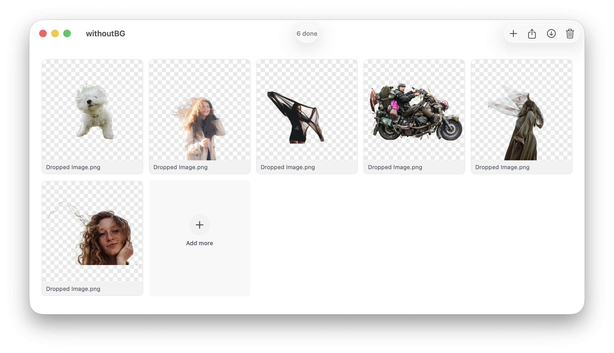
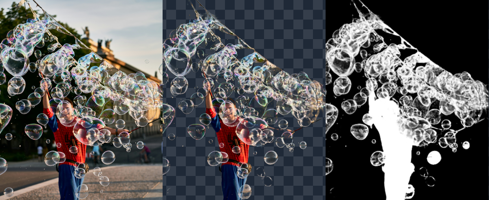
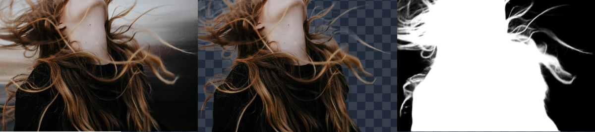
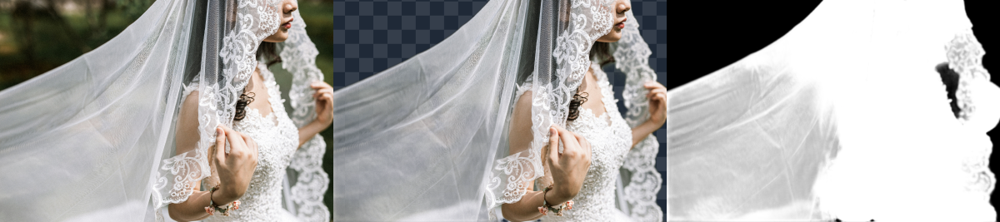
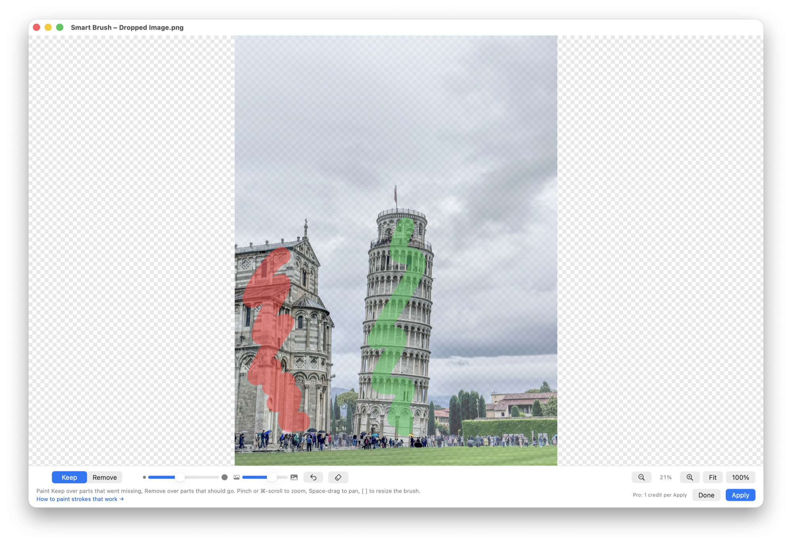

# withoutBG for Mac



**Remove backgrounds on your Mac. Free, private, and local — nothing is uploaded** (unless you opt in to withoutBG Pro).

A native macOS app powered by **withoutBG Open Weights**. Drag and drop images for cutouts, or start the optional **Local API** on `http://127.0.0.1:8000` for scripts, the GIMP plugin, and CI.

**[Download →](https://withoutbg.com/mac?utm_source=github&utm_medium=readme&utm_campaign=open-weights-v4&utm_content=withoutbg-mac-mac)** · **[Local API docs →](https://withoutbg.com/docs/open-model/local-api?utm_source=github&utm_medium=readme&utm_campaign=open-weights-v4&utm_content=withoutbg-mac-docs-open-model-local-api)** · **[Headless / CI →](https://withoutbg.com/mac/headless?utm_source=github&utm_medium=readme&utm_campaign=open-weights-v4&utm_content=withoutbg-mac-mac-headless)**

## See the results





**[Open Weights results →](https://withoutbg.com/open-model/results?utm_source=github&utm_medium=readme&utm_campaign=open-weights-v4&utm_content=withoutbg-mac-open-model-results)** · **[Cloud API results →](https://withoutbg.com/pro-model/results?utm_source=github&utm_medium=readme&utm_campaign=open-weights-v4&utm_content=withoutbg-mac-pro-model-results)** · **[Compare →](https://withoutbg.com/compare/withoutbg-open-model-vs-pro-model?utm_source=github&utm_medium=readme&utm_campaign=open-weights-v4&utm_content=withoutbg-mac-compare-withoutbg-open-model-vs-pro-model)**

## Features

### Desktop

- Drop, open (⌘O), or paste (⌘V) up to **20 images**
- Sequential auto-processing with Quick Look preview, Dock progress, and a notification when a batch finishes
- Responsive thumbnail grid with Photos-style selection; drag results straight out into other apps
- Export transparent, white, or black background PNGs individually or as a zip (original file names kept)
- Light / dark / system appearance
- Finder Services: **Remove Background** on selected images

### Smart Brush

Fix a cutout by painting on it. Right-click a result and choose **Smart Brush…**, paint **Keep** (green) over what went missing and **Remove** (red) over what should go, then press **Apply**. One stroke on an object is enough; the rest of the image stays as it was. Learn which strokes work best in the [Smart Brush guide](https://withoutbg.com/smart-brush?utm_source=github&utm_medium=readme&utm_campaign=open-weights-v4&utm_content=withoutbg-mac-smart-brush).



- Opens in its own resizable window, sized for large and high-resolution displays
- Zoom with pinch or ⌘-scroll, ⌘+ / ⌘− / ⌘0 (fit) / ⌘1 (100%); pan with scroll or Space-drag
- Brush size from the slider or `[` and `]`, with an outline under the pointer; fine enough for pixel-level work when zoomed in
- Background opacity slider to fade the original photo while you paint
- ⌘Z undoes the last stroke; Clear removes all strokes
- Works on Open Weights cutouts (on-device) and on Pro cutouts

### withoutBG Pro (optional)

- Opt-in: add an API key under **Settings ▸ withoutBG Pro** (stored in the Keychain) and switch the engine
- 1 credit per image, and 1 credit per Smart Brush Apply on a Pro cutout
- Off by default; see [Optional: withoutBG Pro](#optional-withoutbg-pro)

### Local API (optional)

- Start/stop from the menu bar extra or Settings
- `POST /v1/remove-background` — same inference engine as the desktop. Send raw image bytes, `multipart/form-data`, or JSON with a base64 `image`; JPEG, PNG, WebP, and HEIC in, PNG out
- `?output=matte` returns the alpha matte instead of the cutout
- Smart brush edits: send `keep_mask` / `remove_mask` (and optionally the previous `matte` or `edit_context`) with the image
- `GET /health`, `GET /openapi.json`
- Request log and operational metrics in the menu bar
- Loopback-only (`127.0.0.1`) — sandboxed, private

## Downloads

Notarized DMGs are published on [GitHub Releases](https://github.com/withoutbg/withoutbg-mac/releases/latest).

| Product | Audience | Scheme |
|---------|----------|--------|
| **withoutBG** (primary) | Creators + developers | `WithoutBG` |
| **WithoutBG Server** (headless) | CI / automation-only | `WithoutBGServer` |

Most users should install **withoutBG**. The headless server build is for environments that only need the HTTP API.

**[Download withoutBG →](https://withoutbg.com/mac?utm_source=github&utm_medium=readme&utm_campaign=open-weights-v4&utm_content=withoutbg-mac-mac)**

## Requirements

- macOS 14+
- Xcode 16+ (Swift 5.9+) — for building from source
- [XcodeGen](https://github.com/yonaskolb/XcodeGen) (`brew install xcodegen`) — for building from source

## Local API quick start

1. Launch **withoutBG**
2. Click the menu bar icon → **Start Local API**
3. Send a request:

```bash
curl -X POST \
  --data-binary @photo.jpg \
  -H "Content-Type: image/jpeg" \
  http://127.0.0.1:8000/v1/remove-background \
  -o result.png
```

Smart brush edit (masks are image-sized, white = painted):

```bash
curl -X POST \
  -F image=@photo.jpg \
  -F keep_mask=@keep.png \
  -F remove_mask=@remove.png \
  http://127.0.0.1:8000/v1/remove-background \
  -o result.png
```

OpenAPI spec: `http://127.0.0.1:8000/openapi.json`

## Optional: withoutBG Pro

By default everything runs on-device. If you have a withoutBG Pro API key, add it under **Settings ▸ withoutBG Pro** (it's stored in the Keychain) and switch the engine to **withoutBG Pro (cloud)**. Each image is then uploaded to api.withoutbg.com, downscaled to 1024 px, and uses 1 credit. The returned matte is applied to your full-resolution original. Smart brush on a Pro cutout runs on Pro too: each Apply sends the photo and every stroke so far (stateless, 1 credit per Apply). The Local API always uses the open weights. Keys: [withoutBG Pro](https://withoutbg.com/pro-model-api?utm_source=github&utm_medium=readme&utm_campaign=open-weights-v4&utm_content=withoutbg-mac-pro-model-api).

## Build & run

The Xcode project is generated from `project.yml` (gitignored).

```bash
xcodegen generate
open WithoutBG.xcodeproj
```

- **WithoutBG** — windowed desktop app with menu bar Local API controls
- **WithoutBGServer** — menu-bar-only headless distribution (`LSUIElement`)

```bash
# Primary app
xcodebuild -scheme WithoutBG -destination 'platform=macOS' build

# Headless server (advanced)
xcodebuild -scheme WithoutBGServer -destination 'platform=macOS' build
```

Release builds:

```bash
./scripts/release.sh                  # withoutBG DMG (primary)
./scripts/release.sh --server           # WithoutBG Server DMG (headless)
```

Background removal runs on-device via the bundled **withoutBG Open Weights** routed bundle (Core ML, v10.12.4). A `MockProcessor` is available behind the same `BackgroundRemovalProcessor` protocol for UI development without the model.

## Repository layout

```
withoutbg-mac/
├── Packages/WithoutBGCore/     Shared inference, model, settings, product links
├── Apps/
│   ├── WithoutBG/              Primary desktop + embedded Local API
│   └── WithoutBGServer/        Headless menu-bar distribution
├── project.yml
└── scripts/release.sh
```

### Inference

Both the desktop queue and Local API serialize through one `SharedInferenceCoordinator` actor backed by a single `CoreMLProcessor` instance — one model load, fair GPU scheduling.

```
Desktop UI ──┐                                                   ┌─ matting  (withoutbg-open-weights)
             ├── SharedInferenceCoordinator ── CoreMLProcessor ── router ─┤
Local API ───┘                                  (backbone + router)      └─ BiRefNet (birefnet-general)
```

Xcode builds compile the bundled `.mlpackage`s to `.mlmodelc` at build time. SwiftPM builds (`swift test`) verify each package against the manifest checksum and compile it once into `~/Library/Application Support/withoutBG/CompiledModels`.

Shared code lives in `Packages/WithoutBGCore`. To run the UI without the model, inject `MockProcessor()` at app init.

## Migration from WithoutBG Server

The standalone `withoutbg-mac-server` is consolidated into this repo; existing installs keep working via the **WithoutBGServer** target, and new users should install **withoutBG**. See [docs/MIGRATION.md](docs/MIGRATION.md).

## More than Mac

This app is the **native desktop** path: drag-and-drop cutouts plus an optional Local API. Same open-weights technology powers the rest of the ecosystem:

| Surface | Choose when |
|---|---|
| **[GIMP plugin](https://github.com/withoutbg/withoutbg-gimp)** | You edit in GIMP 3 and want a private, mask-first workflow via this Local API or Docker |
| **[Docker / self-host](https://github.com/withoutbg/withoutbg-inference)** | You want an HTTP API or browser UI on your own server (CPU or NVIDIA GPU) |
| **[Python package](https://github.com/withoutbg/withoutbg-python)** | You want to embed withoutBG in scripts, notebooks, or backends |
| **[Hugging Face](https://huggingface.co/withoutbg/withoutbg-openweights-onnx)** · **[Space](https://huggingface.co/spaces/withoutbg/withoutbg)** | You want to try a demo or download the ONNX weights directly |
| **[Cloud API](https://withoutbg.com/pro-model?utm_source=github&utm_medium=readme&utm_campaign=open-weights-v4&utm_content=withoutbg-mac-pro-model)** | You need maximum quality without running inference yourself |

## Model

The withoutBG Open Weights Model (v10.12.4, Open Weights v4) is a routed bundle of four Core ML graphs shipped with the app, converted from the published [ONNX bundle](https://huggingface.co/withoutbg/withoutbg-openweights-onnx):

- **Backbone + router** — one DINOv3 ConvNeXt-Base pass at 448² classifies the image and yields shared features.
- **withoutBG matting** — fine strands, soft detail and transparency: Depth Anything V2 Small depth plus the matting trunk, reusing the backbone features.
- **BiRefNet** — hard opaque objects, flat scenes and vehicles: segmentation at 1024² (fp16-stored weights, fp32 compute).
- **Smart brush** — a 2.5 MB stroke-edit network that fixes a cutout from brush strokes (`keep_mask` / `remove_mask` / `matte` on the Local API). Later strokes on the same image skip the full pipeline: in the app automatically, over the Local API by sending back the `editContext` a JSON edit returns as `edit_context`. (Pro Smart brush is stateless instead: every Apply sends the photo and all strokes so far.)

Only the selected branch runs, and its alpha is upsampled to the original resolution. Preprocessing matches the Python SDK and Docker host, and the Local API reports the decision in `X-Route-Category` / `X-Route-Pipeline` headers. Built with DINOv3.

Licensed under the [withoutBG Open Model License](https://withoutbg.com/open-model/license?utm_source=github&utm_medium=readme&utm_campaign=open-weights-v4&utm_content=withoutbg-mac-open-model-license) (Apache 2.0 for withoutBG portions; Meta DINOv3 License for DINOv3 backbone weights). See [THIRD_PARTY_NOTICES](THIRD_PARTY_NOTICES) for model attributions (DINOv3, Depth Anything V2, BiRefNet).

## License

This project’s source code is licensed under the [Apache License 2.0](LICENSE).

Bundled withoutBG Open Weights are distributed under the [withoutBG Open Model License](https://withoutbg.com/open-model/license?utm_source=github&utm_medium=readme&utm_campaign=open-weights-v4&utm_content=withoutbg-mac-open-model-license) (Apache 2.0 for withoutBG portions; Meta DINOv3 License for DINOv3 backbone weights). See [THIRD_PARTY_NOTICES](THIRD_PARTY_NOTICES) for model attributions (DINOv3, Depth Anything V2, BiRefNet).

## Support

- **Bugs / questions:** [GitHub Issues](https://github.com/withoutbg/withoutbg-mac/issues)
- **Product page:** [withoutbg.com/mac](https://withoutbg.com/mac?utm_source=github&utm_medium=readme&utm_campaign=open-weights-v4&utm_content=withoutbg-mac-mac)
- **Commercial:** [contact@withoutbg.com](mailto:contact@withoutbg.com)
